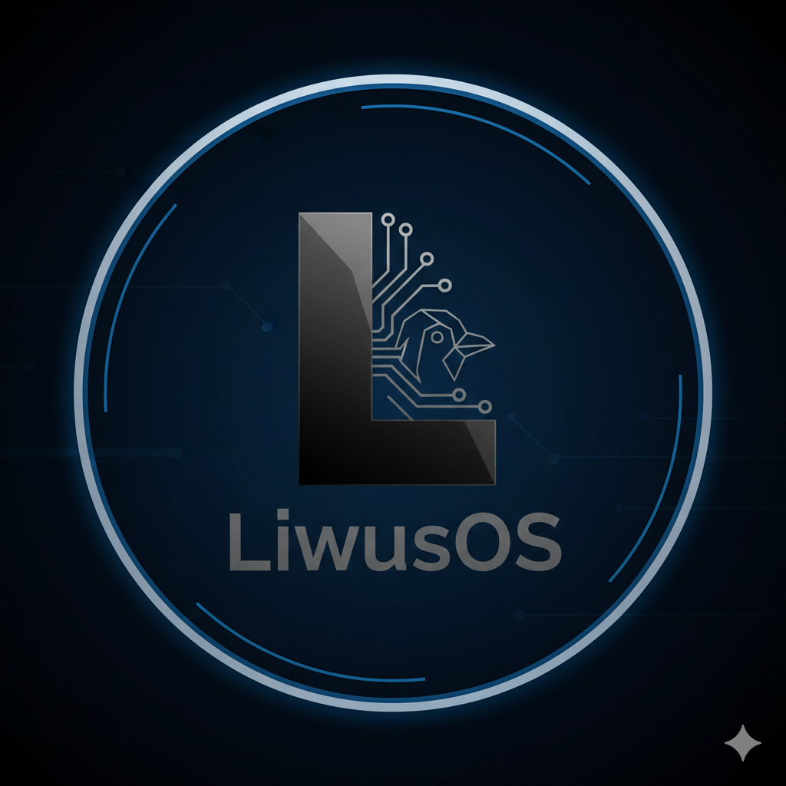

<h1 align="center">
  
  <br />
  LiwusOS
</h1>

<p align="center">
  <strong>A small x86_64 operating system with its own kernel, filesystem and userspace.</strong>
</p>

<p align="center">
  
  
  
  
</p>

---

## What this is

LiwusOS is an experimental, self-contained operating system for x86_64. It boots
from Multiboot2/GRUB, runs its own kernel in long mode, and executes ring-3
programs loaded from its own on-disk filesystem.

The current tree is deliberately **lean and text-mode only**. A previous version
had an in-kernel GUI, SMP bring-up, networking and audio; it was retired because
it could not be maintained or tested. It is preserved as the `legacy-gui` tag and
is **not** part of the build.

The project is now focused on making the existing kernel solid before adding a
Linux ABI compatibility layer. See [docs/ROADMAP.md](docs/ROADMAP.md).

## Implemented

| Area | State |
|---|---|
| Boot | Multiboot2 + GRUB, 32→64-bit transition, higher-half kernel and temporary identity map |
| CPU | GDT, IDT, ISR/IRQ, PIC, LAPIC, PIT at 100 Hz, RTC |
| Memory | Bitmap PMM, 4-level paging, direct map, VMAs, NXE/W^X and usercopy protections |
| Processes | Preemptive thread scheduler, `fork`, `execve`, `waitpid`, blocking pipes, jobs |
| Syscalls | 41 calls through `int $0x80` (see [docs/ABI.md](docs/ABI.md)) |
| Userspace | Ring 3 with validated user/kernel copies |
| Binaries | Static ELF32 and ELF64 (`PT_LOAD` only) |
| Filesystem | VFS + SDFS on ATA/AHCI disks: journal, CRC32, permissions, rename |
| Initrd | tar archive installed into SDFS on first boot |
| Drivers | ACPI, PCI, AHCI, ATA (PIO and bus-master DMA), PS/2 keyboard and mouse, serial, VGA text |
| Shell | LIWUS SDK v0.1 process shell in ring 3; serial/keyboard input, built-ins and `.lxe` fork/exec/wait |
| Tests | 49 named kernel/integration cases, 23 ring-3 subcases and host VMA/parser tests |

## Not implemented (yet)

GUI, GPU acceleration, networking, audio, USB, SMP task scheduling, signal
delivery, demand paging, COW, file-backed `mmap`, dynamic linking, `/proc`,
`/dev`, PTYs, and broad Linux application compatibility remain incomplete.
The Linux x86-64 personality and native ABI exist, but Linux compatibility is
partial and paused for expansion. The roadmap explains the remaining gates.

## Repository layout

```
src/boot/        Multiboot header, long-mode entry, interrupt stubs
src/kernel/arch/ GDT, IDT, ISR, APIC, PIT, RTC, context switch
src/kernel/core/ kernel init, syscalls, ELF loader
src/kernel/mm/   PMM, VMM, kernel heap, user/kernel copy
src/kernel/sched/scheduler, fork, wait, exit
src/kernel/terminal/ in-kernel text terminal and built-in commands
src/fs/          VFS, SDFS, journal, CRC32, initrd
src/drivers/     ACPI, PCI, AHCI, ATA, keyboard, mouse, serial, VGA
programs/        ring-3 init, shell, editor and C example
tests/           in-kernel tests and the ring-3 integration suite
docs/            ABI, roadmap and memory model
```

## Building

Requirements: `gcc`, `binutils`, `make`, `grub-mkrescue`, `xorriso`, `mtools`
and `qemu-system-x86_64` for running.

```sh
make            # kernel.bin + liwusos.iso
make run        # boot the ISO in QEMU
```

The build is warning-free and uses `-Werror`.

## Tests

```sh
make test         # host checks + 49 top-level QEMU cases and ring-3 integration
make test-unit    # harness sensitivity checks + production VMA code on host
make test-stress  # 50,000 fixed-seed host VMA model operations
make ring3-test   # same QEMU suite, validating its ring-3 cases
make smap-test    # same suite with SMAP and 4 vCPUs initialized
make test-all     # all listed quick and QEMU gates, serially
make sdk          # package SDK headers/library/CRT/linker and native-hello.lxe
make sdk-install SDK_PREFIX=/tmp/liwus-sdk  # install public SDK to a chosen prefix
make shell-test   # real QEMU serial input through shell and external SDK app
```

QEMU runs have a 90-second timeout and must exit through `isa-debug-exit` with
the success status. The serial harness rejects missing or duplicate cases,
panic/failure markers, and missing ring-3 results. Unique serial logs are kept
in ignored `test-logs/`; `test_serial.log` is the latest standard run. See
[docs/TESTING.md](docs/TESTING.md) and [docs/TEST_COVERAGE.md](docs/TEST_COVERAGE.md)
for the case inventory and explicit gaps.

The Native SDK v0.1 and `.lxe` ELF convention are documented in
[docs/SDK_LXE.md](docs/SDK_LXE.md). The native userspace shell is described in
[docs/NATIVE_SHELL.md](docs/NATIVE_SHELL.md). `make all` puts `liwsh.lxe` at
`/bin/liwsh.lxe` and the example at `/bin/native-hello.lxe` in the initrd.

## Documentation

- [docs/ROADMAP.md](docs/ROADMAP.md) — the 58 steps and gates towards the Linux ABI
- [docs/ABI_LINUX.md](docs/ABI_LINUX.md) — compatibility architecture decisions
- [docs/MM.md](docs/MM.md) — target memory model (higher-half, direct map, VMAs)
- [docs/ABI.md](docs/ABI.md) — the native syscall ABI as it exists today
- [docs/TESTING.md](docs/TESTING.md) — reproducible test targets and harness rules
- [docs/TEST_COVERAGE.md](docs/TEST_COVERAGE.md) — active test inventory and known gaps

## Status and scope

This is a hobby/educational kernel. It is not a Linux distribution, does not
aim to be POSIX-complete today, and its finite test suite is not a security or
data-integrity guarantee.

## License

MIT. See [LICENSE](LICENSE).

## Linux compatibility (paused) & native ABI development

- **Linux x86-64 compatibility (PAUSED)**: The isolated Linux personality implements a limited, tested subset. The current probes are regression evidence, not general Linux application compatibility. Expansion is paused to prioritize the native Liwus ABI. Documentation for resuming: [docs/linux-compat/HANDOFF.md](docs/linux-compat/HANDOFF.md), [docs/linux-compat/IMPLEMENTATION_STATUS.md](docs/linux-compat/IMPLEMENTATION_STATUS.md), [docs/linux-compat/RESUME_PLAN.md](docs/linux-compat/RESUME_PLAN.md), [docs/linux-compat/KNOWN_ISSUES.md](docs/linux-compat/KNOWN_ISSUES.md), [docs/linux-compat/REPRODUCIBILITY.md](docs/linux-compat/REPRODUCIBILITY.md). See also [docs/ABI_LINUX.md](docs/ABI_LINUX.md).
- **Native Liwus ABI**: Native ABI is primary. Development docs: [docs/native-abi/ARCHITECTURE.md](docs/native-abi/ARCHITECTURE.md), [docs/native-abi/SYSCALL_REFERENCE.md](docs/native-abi/SYSCALL_REFERENCE.md), [docs/native-abi/DEVELOPMENT_PLAN.md](docs/native-abi/DEVELOPMENT_PLAN.md), [docs/native-abi/GETTING_STARTED.md](docs/native-abi/GETTING_STARTED.md).
- **Project handoff (central entry)**: [docs/PROJECT_HANDOFF.md](docs/PROJECT_HANDOFF.md)
# Install native applications

Compile an external static `.lxe` with the Native SDK, stop QEMU, and install
it into an existing SDFS disk image:

```sh
make sdk-install SDK_PREFIX=/tmp/liwus-sdk
make app-install APP=/path/to/app.lxe DISK=/path/to/liwus.img
make run
```

Use `REPLACE=1` to update an existing `/bin` entry. The installer is a host
tool and requires the disk image to be offline. See
[`docs/SDFS_INSTALL.md`](docs/SDFS_INSTALL.md) for ELF checks, persistence
behavior, safety limits, and `make app-install-test`.
