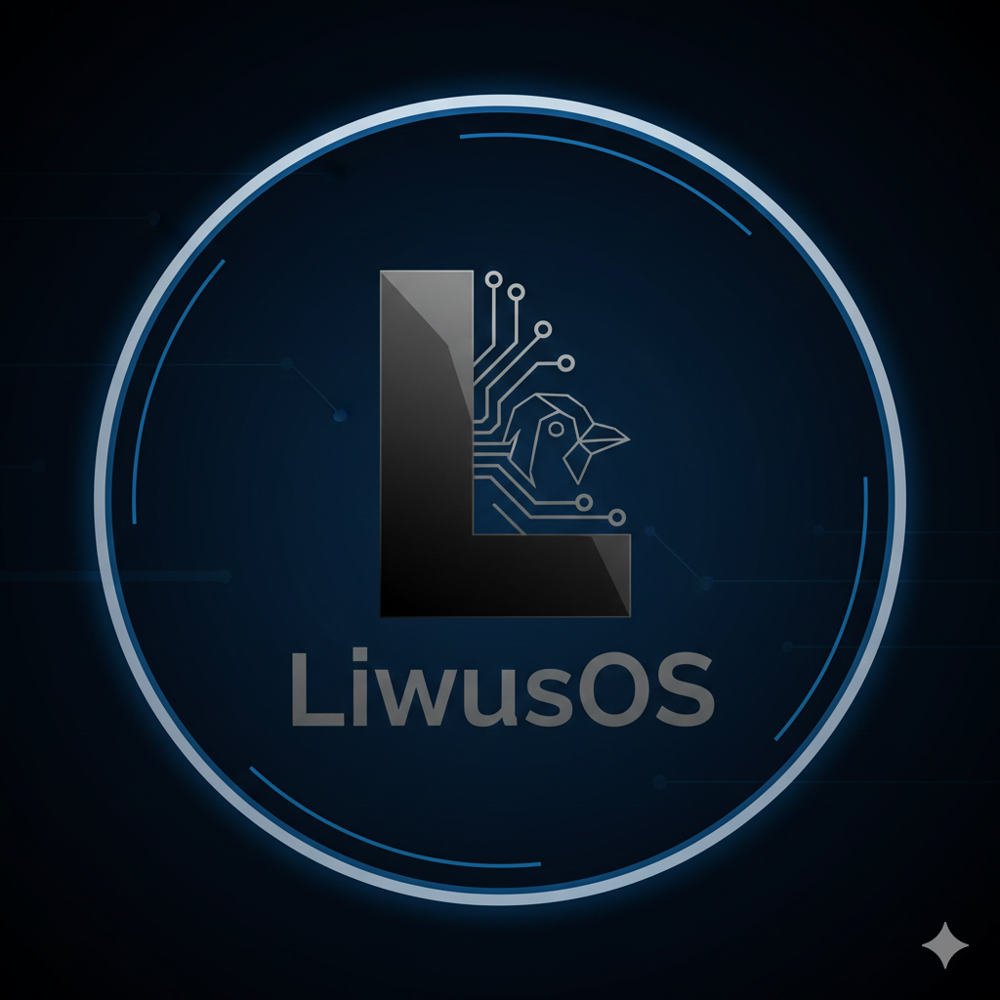

<h1 align="center">
  
  <br />
  LiwusOS
</h1>

<p align="center">
  <strong>A small x86_64 operating system with its own kernel, filesystem and userspace.</strong>
</p>

<p align="center">
  
  
  
  
</p>

---

## What this is

LiwusOS is an experimental, self-contained operating system for x86_64. It boots
from Multiboot2/GRUB, runs its own kernel in long mode, and executes native
ring-3 programs from SDFS. The current release line is 2.2.21. The tree includes
an LVGL desktop, a native browser, networking, audio support, a native SDK and
the `lpkg` system updater; this is an active experimental system, not a finished
desktop distribution.

## Implemented

| Area | State |
|---|---|
| Boot and CPU | Multiboot2/GRUB, x86-64 long mode, higher-half kernel, GDT/IDT, interrupts, LAPIC/PIT/RTC |
| Memory and processes | Bitmap PMM, 4-level paging, direct map, VMAs, NXE/W^X, ring-3 processes and threads, blocking pipes |
| Native interface | LIWUS syscall ABI, `.lxe` ELF applications, SDK, shell, editor and command-line utilities |
| Storage | VFS + SDFS on ATA/AHCI, journal, CRC32, permissions, rename and first-boot installation |
| Desktop | LVGL desktop, windows, launcher/taskbar, Settings, calculator, DOOM and SNES emulator |
| Web | LiwusWeb HTML/CSS renderer with JavaScript through QuickJS; support is bounded and documented in [docs/BROWSER_COMPATIBILITY.md](docs/BROWSER_COMPATIBILITY.md) |
| Network | lwIP, e1000 and RTL8168 drivers, DHCP/DNS, HTTP(S), NTP, telnet and OTA updates |
| Audio and input | HDA audio driver; USB xHCI/EHCI keyboard and mouse paths, with physical H61 USB keyboard evidence |
| Display | GRUB chooses a supported framebuffer mode without a fixed resolution request. The kernel reads EDID and selects the largest advertised mode on QEMU Standard VGA; physical GPU modesetting is not implemented yet |
| System update | `lpkg sysupdate` downloads and validates the system archive and boot image from the `pkg-repo` feed |
| Verification inventory | 51 named kernel/integration cases, 23 ring-3 markers and host VMA/parser/USB checks; see [docs/TEST_COVERAGE.md](docs/TEST_COVERAGE.md) |

## Not implemented (yet)

LiwusOS does not have a general GPU/KMS driver or hardware acceleration. The
Settings app can change modes on QEMU Standard VGA; on the physical H61 PC it
reports the PCI graphics adapter so a matching driver can be implemented.
USB mass-storage support, general USB hot-plug, SMP task migration, signals,
demand paging, COW, file-backed `mmap`, dynamic linking, `/proc`, `/dev`, PTYs,
and broad Linux application compatibility remain incomplete. The Linux x86-64
personality is an isolated, partial compatibility layer; the native Liwus ABI
remains primary. See [docs/ROADMAP.md](docs/ROADMAP.md) for open gates.

## Repository layout

```
src/boot/        Multiboot header, long-mode entry, interrupt stubs
src/kernel/arch/ GDT, IDT, ISR, APIC, PIT, RTC, context switch
src/kernel/core/ kernel init, syscalls, ELF loader
src/kernel/mm/   PMM, VMM, kernel heap, user/kernel copy
src/kernel/sched/scheduler, fork, wait, exit
src/kernel/gui/     LVGL desktop and LiwusWeb renderer
src/kernel/terminal/ in-kernel terminal, package manager and built-in commands
src/fs/          VFS, SDFS, journal, CRC32, initrd
src/net/         lwIP, TLS and network services
src/drivers/     ACPI, PCI, storage, USB HID, audio, keyboard, mouse, framebuffer
programs/        ring-3 utilities, SDK apps, browser runtime and SNES emulator
tests/           in-kernel tests and the ring-3 integration suite
docs/            ABI, roadmap and memory model
```

## Building

Requirements: `gcc`, `binutils`, `make`, `grub-mkrescue`, `xorriso`, `mtools`
and `qemu-system-x86_64` for running.

```sh
make            # kernel.bin + liwusos.iso
make run        # boot the ISO in QEMU
```

The build is warning-free and uses `-Werror`.

## Tests

```sh
make test         # host checks + 51 top-level QEMU cases and ring-3 integration
make test-unit    # harness + VMA, shell parser and USB host tests
make test-stress  # 50,000 fixed-seed host VMA model operations
make ring3-test   # same QEMU suite, validating its ring-3 cases
make smap-test    # same suite with SMAP and 4 vCPUs initialized
make test-all     # all listed quick and QEMU gates, serially
make sdk          # package SDK and build liwsh, ls.lxe, cat.lxe, native-hello.lxe
make sdk-install SDK_PREFIX=/tmp/liwus-sdk  # install public SDK to a chosen prefix
make shell-test   # real QEMU serial input through shell and external SDK app
```

QEMU runs have a 90-second timeout and must exit through `isa-debug-exit` with
the success status. The serial harness rejects missing or duplicate cases,
panic/failure markers, and missing ring-3 results. Unique serial logs are kept
in ignored `test-logs/`; `test_serial.log` is the latest standard run. See
[docs/TESTING.md](docs/TESTING.md) and [docs/TEST_COVERAGE.md](docs/TEST_COVERAGE.md)
for the case inventory and explicit gaps.

The Native SDK v0.1 and `.lxe` ELF convention are documented in
[docs/SDK_LXE.md](docs/SDK_LXE.md); loader internals and technician procedures
are in [docs/LXE_TECHNICAL.md](docs/LXE_TECHNICAL.md). The native userspace shell is described in
[docs/NATIVE_SHELL.md](docs/NATIVE_SHELL.md). `make all` puts `liwsh.lxe` at
`/bin/liwsh.lxe` and the example at `/bin/native-hello.lxe` in the initrd.

## Documentation

- [docs/ROADMAP.md](docs/ROADMAP.md) — the 58 steps and gates towards the Linux ABI
- [docs/ABI_LINUX.md](docs/ABI_LINUX.md) — compatibility architecture decisions
- [docs/MM.md](docs/MM.md) — target memory model (higher-half, direct map, VMAs)
- [docs/ABI.md](docs/ABI.md) — the native syscall ABI as it exists today
- [docs/TESTING.md](docs/TESTING.md) — reproducible test targets and harness rules
- [docs/TEST_COVERAGE.md](docs/TEST_COVERAGE.md) — active test inventory and known gaps

## Status and scope

This is a hobby/educational kernel. It is not a Linux distribution, does not
aim to be POSIX-complete today, and its finite test suite is not a security or
data-integrity guarantee.

## License

MIT. See [LICENSE](LICENSE).

## Native ABI and Linux compatibility

- **Linux x86-64 compatibility**: The isolated personality implements a partial, tested syscall/ELF subset. QEMU probes are regression evidence, not general Linux application compatibility. Open work and limitations: [docs/linux-compat/HANDOFF.md](docs/linux-compat/HANDOFF.md), [docs/linux-compat/IMPLEMENTATION_STATUS.md](docs/linux-compat/IMPLEMENTATION_STATUS.md), [docs/linux-compat/RESUME_PLAN.md](docs/linux-compat/RESUME_PLAN.md), [docs/linux-compat/KNOWN_ISSUES.md](docs/linux-compat/KNOWN_ISSUES.md), [docs/linux-compat/REPRODUCIBILITY.md](docs/linux-compat/REPRODUCIBILITY.md). See also [docs/ABI_LINUX.md](docs/ABI_LINUX.md).
- **Native Liwus ABI**: Native ABI is primary. Development docs: [docs/native-abi/ARCHITECTURE.md](docs/native-abi/ARCHITECTURE.md), [docs/native-abi/SYSCALL_REFERENCE.md](docs/native-abi/SYSCALL_REFERENCE.md), [docs/native-abi/DEVELOPMENT_PLAN.md](docs/native-abi/DEVELOPMENT_PLAN.md), [docs/native-abi/GETTING_STARTED.md](docs/native-abi/GETTING_STARTED.md).
- **Project handoff (central entry)**: [docs/PROJECT_HANDOFF.md](docs/PROJECT_HANDOFF.md)
# Install native applications

Compile an external static `.lxe` with the Native SDK, stop QEMU, and install
it into an existing SDFS disk image:

```sh
make sdk-install SDK_PREFIX=/tmp/liwus-sdk
make app-install APP=/path/to/app.lxe DISK=/path/to/liwus.img
make sdfs-put FILE=assets/readme.txt DEST=/readme.txt DISK=/path/to/liwus.img REPLACE=1
make run
```

Use `REPLACE=1` to update an existing `/bin` entry. The installer is a host
tool and requires the disk image to be offline. See
[`docs/SDFS_INSTALL.md`](docs/SDFS_INSTALL.md) for ELF checks, persistence
behavior, safety limits, and `make app-install-test`.

The native shell resolves exact executable names first, then tries the `.lxe`
suffix and `/bin` candidates. `ls` and `cat` are separate ring-3 SDK programs;
directory enumeration uses the native `getdents` VFS interface. A fresh SDFS
receives `/readme.txt` from the initrd. Persistent disks are not overwritten
from later initrds; use `make sdfs-put` for an explicit data-file update.

The kernel's replacement and journal protocol is documented in
[`docs/SDFS_TRANSACTIONS.md`](docs/SDFS_TRANSACTIONS.md).
